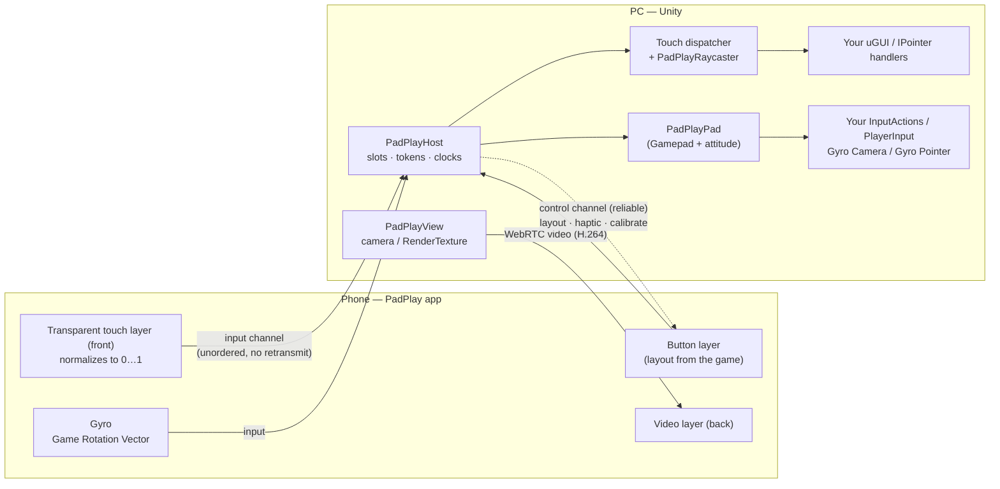
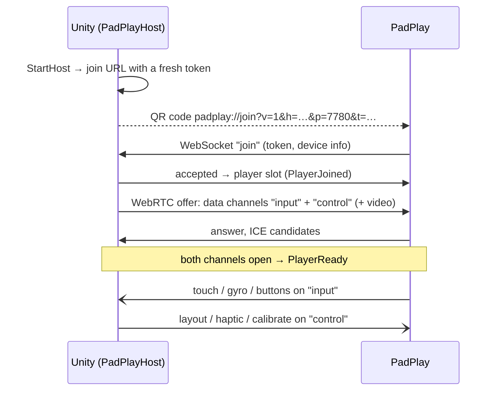

# Concepts

> This is the online copy of the documentation that ships inside the package (`Documentation~`). SDK 0.2.0. [All pages](./) · [Support](https://github.com/Petaf000/PadPlay)

PadPlay SDK turns a phone into a Wii U GamePad–style controller: a touch screen that shows its own view of the game,
plus a gyro and on-screen buttons. This page explains *how* it is put together and *why*, so the behaviour you see in
[Quick Start](QuickStart.md) is not a surprise.

## Where the ideas come from

The SDK grew out of the student project that inspired it — a two-player co-op game played on a big screen plus a tablet
with a hand-made controller and a gyro sensor. On the tablet, one player looked *into* the comic-panel world
by tilting it, and touched the game directly. Making that work taught a handful of lessons, and each of them is now a
part of the SDK:

| Lesson from the original project | What the SDK does |
|---|---|
| Debugging was only possible with the special hardware in one room. | Touch is injected as **standard uGUI events**, so the mouse works identically. |
| A transparent touch layer over the streamed picture felt instant. | The phone app has **two layers**: video behind, a transparent touch layer in front. |
| Window size and resolution kept changing. | Touch is sent as **normalized coordinates** (0…1). |
| Several wireless controllers cross-talked unless each was addressed by name. | Each phone gets a **player slot**; a **token in the QR code** decides who may join. |
| Masked images blocked rays and transparent pixels were hit. | A **custom raycaster** with per-player screens and alpha hit testing. |
| The controller was exposed as a custom Input System device. | Each phone is a **`PadPlayPad`**, which *is a* `Gamepad`. |
| External streaming tools and custom hardware were fragile. | Video is streamed by the SDK itself (WebRTC); the phone's own sensors replace the hardware. |

## The big picture

### Core and Unity

The package has two assemblies:

- **`PadPlay.Core`** — plain C# (C# 9, netstandard2.1, no engine references): the protocol, sessions and signaling,
  coordinate mapping, attitude math, clock sync, QR encoding. Everything that can be tested without Unity lives here, so
  other engines can reuse it later.
- **`PadPlay.Unity`** — the adapters: `PadPlayHost`, event injection, the raycaster, the Input System device,
  video, gyro components and UI helpers.

As a game developer you mostly touch `PadPlay.Unity`. A few Core types appear in its API (for example
`AttitudeCalibrationMode`, `ClockSync`, `DeviceInfo`), so some scripts also need `using PadPlay.Core.Input;`.
The rest of Core (packet encoders such as `TouchPacket`, `PointerTracker`, `SignalingServer`, `JoinRequest`) is public for
advanced use — fake phones in tests or an integration for another engine — and is not needed in a Unity game.

### Modules

The host has four modules, ticked in its Inspector (`host.Settings.Modules`, a `PadPlayModules` flags value):
**Touch**, **Attitude**, **Buttons** (including haptics) and **Video**. Each has its own settings object
(`Settings.Touch`, `Settings.Attitude`, `Settings.Buttons`, `Settings.Video`).

The phone app always sends everything it has; the module switch works on the host side. An unticked module's input is
dropped before it reaches uGUI, the events or the `PadPlayPad`, and nothing is sent for it (no layout, no vibration,
no video). The Debugger still counts what arrives, so "the phone sends nothing" and "the module is off" look different.

## Connecting: the QR code and player slots

- The QR code contains the PC's LAN address, the port and a **token**. Only phones presenting the current token are
  accepted. `RenewToken()` makes a new code; already-joined phones stay.
- Each accepted phone gets a **player slot** (0, 1, 2 …). Every input event, every `PadPlayPointerEventData` and
  every `PadPlayPad` carries that slot, so two players never mix.
- If a phone drops without saying goodbye (Wi-Fi blip, app sent to background or closed), its slot is **held** for
  `ResumeHoldSeconds` (60 s). When it comes back it gets the same slot and the same `PadPlayPad` device
  (`PlayerJoined` with `Resumed = true`). The app keeps a per-game resume key and a device id, so this also works after
  the app was closed and started again. `PlayerLeft.Reason` tells you why a phone left (`bye`, `closed`, `timeout`, `stopped`, …).
- When the slot is free for good — the player said bye, the host stopped, or the hold time ran out — `PlayerRemoved`
  fires (Reason `bye`, `stopped` or `expired`). The hold time is counted in Core, in one place; `GetPlayerState(slot)`
  returns `Connecting`, `Ready`, `Reconnecting` or `Gone`.
- `AcceptNewPlayers = false` closes the lobby: new phones are refused as "full", held slots can still resume.
- Only the same LAN is supported. No STUN/TURN servers are used.

### Two channels

| Channel | Delivery | Carries |
|---|---|---|
| `input` | unordered, no retransmission | touch, attitude, buttons — a late packet is useless, a newer one replaces it |
| `control` | reliable, ordered | touch down/up and button changes (sent again here so a tap or a press is never lost), layout, haptics, calibration, clock ping/pong, screen orientation |

Old or duplicated input packets are dropped by sequence number. Your code only sees the events in order, on the main thread.
A button press that arrives late on `control` is still applied once (then the current state), and the pad changes a given
button at most once per Input System update, so a press and release in the same frame are both seen.

## Touch

### Two layers and normalized coordinates

On the phone the video sits behind a transparent touch layer. The touch layer reacts immediately (the finger does
not wait for the video round trip) and reports each finger as **(0, 0)–(1, 1) relative to the video area**,
letterbox excluded, with **y pointing down** (top-left origin). The Host maps it to pixels of whatever that player
is looking at — Display 1, a rectangle of a display, or a camera — so resolution and window size never shift touches.

### Injected as standard events

The SDK does **not** replace your input module. For each finger it keeps its own `PointerEventData`
(`PadPlayPointerEventData`) and calls the same `ExecuteEvents` handlers an input module would:
`OnPointerEnter/Exit/Down/Up/Click`, `OnBeginDrag/OnDrag/OnEndDrag`, … with the usual drag threshold and click timing.
Consequences:

- Existing Buttons, Sliders and `IDragHandler`s work without changes.
- The mouse keeps working at the same time, with its own pointer data. You can develop without a phone.
- To know *who* touched, test `eventData is PadPlayPointerEventData p` and read `p.PlayerSlot`.
- Pointer ids are allocated far away from mouse and local-touch ids, so they never collide.

### Per-player screens and the raycaster

When several players each see their own view (split screen, Display 2, or a video sent to their phone), a touch must
only hit what *that* player sees. The dispatcher runs the normal `EventSystem.RaycastAll` and then keeps only results
from raycasters that belong to the player's screen (decided by `BaseRaycaster.eventCamera`).

`PadPlayRaycaster` is a drop-in `GraphicRaycaster` that additionally ignores hits on **transparent pixels**
of an `Image` (`AlphaThreshold`, default 0.1). It works for Screen Space and World Space canvases and for the mouse.

## Gamepad, gyro and buttons

### PadPlayPad is a Gamepad

Each ready phone becomes an Input System device `PadPlayPad : Gamepad`. Inheriting from `Gamepad` means existing
`<Gamepad>/…` bindings, `Gamepad.all` and `PlayerInput` control schemes work unchanged. It adds the controls `attitude`,
`angularVelocity`, `playerSlot` and game-defined buttons `custom14`…`custom31` (lower-case, like other Input System
controls); C# values are PascalCase (`PlayerSlot`, `IsConnected`, `ButtonBits`, `GetButton(id)`). The pad exists from just
before `PlayerReady` until just before `PlayerRemoved`. Gyro controls are marked *noisy*, so
holding the phone does not steal `Gamepad.current`. The device runs in the background, so input keeps arriving when the
PC window loses focus. Rumble (`SetMotorSpeeds`) drives the phone's vibration.

### Attitude

The phone sends its **Game Rotation Vector** (a quaternion fused from gyro and accelerometer, without the magnetometer —
the same choice the original project made with its sensor) and angular velocity. The SDK converts it to Unity's
left-handed space, where **identity = phone upright in portrait, screen facing you**, and:

- **calibrates yaw on connect** (the direction the player faces becomes forward);
- **smooths over network jitter**: samples carry the phone's timestamp; with the clock offset from ping/pong the SDK
  extrapolates a short way and blends corrections in, so the camera does not stutter when packets bunch up.

`PadPlayGyroCamera` and `PadPlayGyroPointer` sit on top of this. Their re-centering is local to the
component, so it does not change the pad's attitude that other code reads.

Naming: components you add are called **Gyro** (`PadPlayGyroCamera`); the data is called **attitude**
(`AttitudeReceived`, `pad.attitude`, the `Attitude` module). Every calibration takes one enum, `AttitudeCalibrationMode`
(`Yaw` or `Full`).

Coordinates: phone positions (`PadPlayPointerEventData.PhonePosition`, layouts) have **y = 0 at the top**;
the gyro pointer's `ViewportPosition` is Unity viewport space with **y = 0 at the bottom**. The names say which.

### Buttons are a layout the game sends

The phone has no fixed button set. The game sends a **layout** — ids, shapes, centers and sizes in the same 0…1
video-area coordinates as touch — and the phone draws it above the touch layer. Fingers that start on a button go to
the button — or within 2.5 mm of its edge, to the nearest button (a setting of the app, not of the layout);
all others are touches. Pressed bits and stick values come back on the `input` channel and land in the
`PadPlayPad`. Changing the layout asset while playing resends it, so positions can be tuned by hand.

## Second screen (video)

`PadPlayView` streams a camera or RenderTexture to one player (or to everyone) over WebRTC, preferring H.264 so that
NVIDIA's hardware encoder (NVENC) is used. Adding or changing a view while connected renegotiates by rebuilding that
player's connection (`PlayerReady` fires again; the slot and the pad stay). Cameras that nobody watches are disabled.

## Tuning by feel

Latency, smoothing, sensitivity and dead zones cannot be judged on paper. Every such value is a field in an Inspector
settings object (`Settings.Touch`, `Settings.Attitude`, `Settings.Buttons`, the gyro components' `Settings`, the button layout) and most can be
changed while playing. Defaults are starting points, not final answers. Use the Display preview and the Debugger
([Debugging](Debugging.md)) to see the numbers while you tune.
